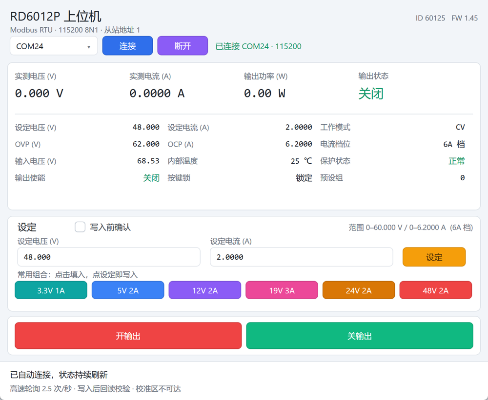

# tiny-riden-psu

A Windows desktop controller for the RIDEN RD6012P bench power supply. One 25 KB executable, no C runtime, no Qt, Electron or .NET; the UI is drawn with the Direct2D and DirectWrite components shipped with Windows.



[中文说明](README.md)

## Features

- Single executable, no installer, no runtime dependency.
- Live readout: output voltage, current, power, output state, setpoints, OVP, OCP, input voltage, internal temperature, regulation mode, current range, protection state, key lock, preset group.
- Voltage and current setpoints written with a single Modbus 0x10 request, verified by reading back.
- Output on/off with read-back verification and a setpoint check before energising.
- Six preset voltage/current pairs, filled into the input fields only.
- Event-driven polling: the next frame is sent as soon as a validated reply arrives, no pacing timer.
- Optimistic UI: numbers change on click, then reconcile with the read-back or roll back.
- High DPI and narrow-window layout, minimum 640×640 logical pixels.

## Scope

| Item | Value |
| --- | --- |
| Device | RIDEN RD6012P (model ID 60125, firmware 1.45 tested) |
| Interface | USB serial CH340, Modbus RTU |
| Serial | 115200, 8 data bits, no parity, 1 stop bit, slave 1 |
| Output | 0–60.000 V, 0–12.000 A, 0–720 W |
| Current range | 6 A range 0–6.2000 A (0.0001 A), 12 A range 0–12.000 A (0.001 A) |
| OS | Windows 10 / 11, x86 |
| Toolchain | Visual Studio 2022 with Desktop development with C++ and Windows 10 SDK |

Other RD60xx models use different register layouts and scaling and are not verified.

## Build

```bat
cd pc-ui
build.bat
```

The output is `pc-ui\build\tinyapp.exe`. Set `APP` to change the file name.

```bat
cd pc-ui\tools
build-tools.bat
```

## Run

Start `pc-ui\build\tinyapp.exe`. It connects automatically to the highest-numbered serial port. Use the dropdown to switch ports if the supply is attached elsewhere.

## Safety

The supply can deliver 60 V, 12 A and 720 W. The program refuses setpoint changes while the output is enabled, verifies every write by reading it back, checks range and OVP limits, exposes only three writable registers, and leaves the calibration area unreachable. Read the full notes in [SECURITY.md](SECURITY.md) before connecting a load.

## Performance

At 115200 8N1 a status frame is 55 bytes and takes 4.8 ms on the wire. Measured polling is 2.55 Hz with the output off and 4.2 Hz with the output on, a bus utilisation of 1.22% and about 2.0%. The device firmware processes roughly one request every 392 ms regardless of frame gap or register count, so bus utilisation is bounded by the device, not by this program.

## License

[MIT](LICENSE)
