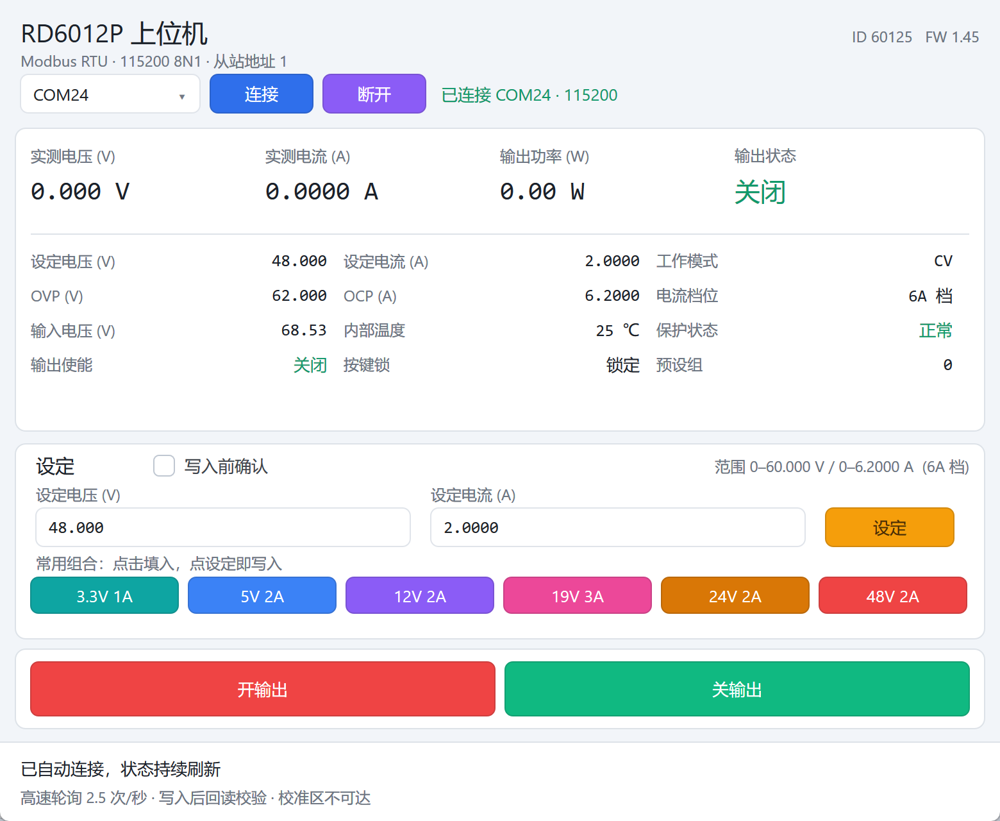

# tiny-riden-psu

睿登 RD6012P 直流电源的 Windows 桌面控制程序。单个 25 KB 可执行文件，不链接 C 运行库，不使用 Qt、Electron 或 .NET，界面由系统自带的 Direct2D 与 DirectWrite 绘制。



## 特性

- **单文件免安装**：25,088 字节，无运行时库依赖，双击即用。
- **实时状态**：实测电压、实测电流、输出功率、输出状态、设定值、OVP、OCP、输入电压、内部温度、工作模式、电流档位、保护状态、按键锁、预设组。
- **设定电压与电流**：一次 0x10 批量写完成，写入后读回校验。
- **输出开关**：写入后读回校验，开启前核对当前设定值。
- **常用组合**：3.3V 1A、5V 2A、12V 2A、19V 3A、24V 2A、48V 2A，点击填入输入框。
- **事件驱动轮询**：收到校验通过的回复帧立即发下一帧，无定时器节拍，无请求间固定等待。
- **点击即显示**：点击后数字立即变为目标值，回读一致后校准，失败或超时回滚。
- **高 DPI 与窄屏自适应**：窗口最小 640×640 逻辑像素，布局按宽度流式排布。

## 适用范围

| 项目 | 值 |
| --- | --- |
| 设备 | 睿登 RD6012P（型号 ID 60125，固件 1.45 实测） |
| 接口 | USB 转串口 CH340，Modbus RTU |
| 串口参数 | 115200，8 位数据，无校验，1 位停止，从站地址 1 |
| 输出范围 | 0–60.000 V，0–12.000 A，0–720 W |
| 电流量程 | 6A 量程 0–6.2000 A（分辨率 0.0001 A），12A 量程 0–12.000 A（分辨率 0.001 A） |
| 操作系统 | Windows 10 / 11，x86 |
| 构建环境 | Visual Studio 2022（C++ 桌面开发）+ Windows 10 SDK |

RD60xx 系列其他型号的寄存器布局与量纲不同，本程序未在这些型号上验证。设备侧 6A 与 12A 量程切换需要在面板菜单操作，程序会读取当前量程并据此换算电流。

## 快速开始

### 构建

需要 Visual Studio 2022 的「使用 C++ 的桌面开发」工作负载和 Windows 10 SDK。构建脚本直接按目录结构设置 `INCLUDE` 与 `LIB`，不调用 `vcvars*.bat`。

```bat
cd pc-ui
build.bat
```

产物为 `pc-ui\build\tinyapp.exe`。可用环境变量 `APP` 指定产物名：

```bat
set APP=riden-psu
build.bat
```

构建验证工具：

```bat
cd pc-ui\tools
build-tools.bat
```

### 运行

直接运行 `pc-ui\build\tinyapp.exe`。程序启动后自动连接编号最大的串口（USB 转串口设备通常编号最大），状态栏显示「已自动连接，状态持续刷新」。若设备接在其他端口，用顶部下拉框切换后点「连接」。

## 界面与操作

顶部是串口选择与连接控制，其下是状态面板，再下是设定面板与输出开关，底部是状态栏。

- **设定**：在「设定电压」「设定电流」填入数值后点「设定」。电压 3 位小数，电流按当前量程 3 位或 4 位小数。
- **写入前确认**：勾选后每次写入弹出确认条，需要再点「确认」；不勾选时点「设定」或「开输出」直接执行。默认不勾选。
- **常用组合**：点击后只填入输入框，不写设备。
- **开输出 / 关输出**：关输出可随时执行；开输出在勾选「写入前确认」时需要核对当前设定值。

## 安全设计

本程序控制的是能输出 60 V、12 A、720 W 的电源，误操作可能损坏负载或造成人身危险。

- **改设定值前要求输出关闭**：输出开启时拒绝修改电压或电流，避免带载跳压。
- **写入后回读校验**：每次写入都读回寄存器比对，不一致则报错并回滚界面显示。
- **量程与保护检查**：目标电压不得超过 60.000 V 与当前 OVP 阈值，目标电流不得超过当前量程上限。
- **无寄存器裸写入口**：只允许写设定电压、设定电流、输出使能三个寄存器。校准区（55–64）与 bootloader（256）不可达。
- **二次确认可开关**：默认关闭以保持操作流畅，需要严格模式时勾选「写入前确认」。

使用前请确认负载额定值与设定值匹配。开启输出前先核对设定电压。

## 性能

链路 115200 8N1 为 11520 字节/秒。一帧状态读为请求 8 字节加响应 47 字节，纯传输 4.8 ms。

| 指标 | 实测 |
| --- | --- |
| 连续轮询帧率 | 2.55 次/秒（输出关闭），4.2 次/秒（输出开启） |
| 总线带宽利用率 | 1.22%（输出关闭），约 2.0%（输出开启） |
| 设定电压与电流 | 2 帧，797 ms |
| 点击到界面变化 | 当帧，0 帧延迟 |

设备固件约每 392 ms 处理一次请求（输出关闭），帧间隔从 0 到 150 ms 时总周期恒定，读取 1 到 21 个寄存器时延一致，两帧连续发送设备不响应。等待响应的这段时间总线必然空闲，带宽利用率的上限由设备决定，提高波特率会让空闲占比更高。

## 已知限制

- 只验证了 RD6012P 与固件 1.45。
- 设备待机（面板电源键关闭屏幕）后串口是否仍可通信未验证。
- 真机带载测试未执行，只在空载下验证。
- 6A 量程上限按 6.2000 A 处理，依据是本机 OCP 阈值；12A 量程上限按型号标称 12.000 A 处理，未实测。
- 仅支持 Windows x86，无跨平台计划。

## 目录结构

```
pc-ui/
  build.bat            构建主程序
  env.bat              定位 MSVC 与 Windows SDK
  src/
    app.c              窗口、立即模式绘制、消息循环
    session.c/.h       连接生命周期、显示副本、动作入口
    device.c/.h        动作计划执行器、量纲换算、寄存器护栏
    ui.cpp/.h          立即模式 UI 内核（Direct2D + DirectWrite）
    rt.c               无 C 运行库所需的辅助函数
  transport/
    modbus_rtu.c/.h    通用 Modbus RTU 主站
    serial_io.c/.h     Win32 串口字节流后端
  tools/
    mb_test.c          传输层回归测试
    plan_test.c        动作计划帧数验证
    rate_test.c        连续轮询帧率测量
    live_test.c        真串口读取诊断
    shot.c/click.c/keys.c  界面验证工具
  screenshots/         界面截图
docs/
  ARCHITECTURE.md      分层、状态归属、数据流
  PROTOCOL.md          寄存器表与报文
```

## 测试

```bat
cd pc-ui\tools
build-tools.bat
mb_test.exe        :: 传输层回归，25 项
plan_test.exe      :: 动作计划帧数，需要连接设备
rate_test.exe      :: 连续轮询帧率，需要连接设备
live_test.exe      :: 读取一次寄存器块，需要连接设备
```

`mb_test.exe` 使用内存字节流后端，不占用串口，覆盖半包、粘包、非请求帧穿插、并发请求、超时后迟到帧丢弃、断线重连、0x10 批量写。

## 协议

寄存器表、量纲换算、双量程差异与报文示例见 [docs/PROTOCOL.md](docs/PROTOCOL.md)。

## 许可

[MIT](LICENSE)

## 致谢

界面内核与验证工具骨架来自本地 `tiny-win32-gui` 技能资产，本项目在其上扩展了彩色按钮与等宽 20 像素文本格式。寄存器含义参考了社区逆向资料，详见 [THIRD-PARTY.md](THIRD-PARTY.md)。
